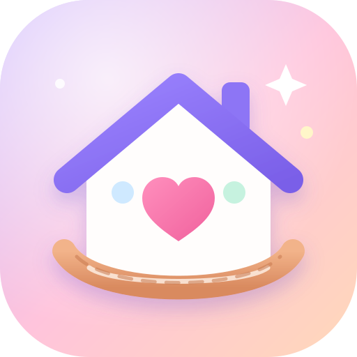
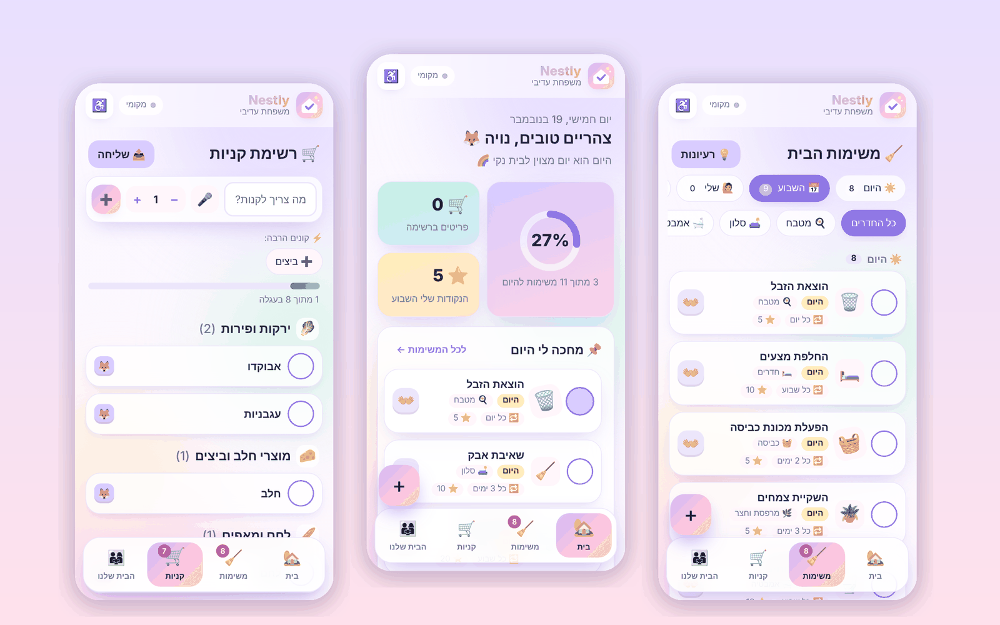

<div align="center">

[](https://noyaadivi.github.io/nestly/)

# Nestly

[English](README.md) · **עברית**

**הבית, ביחד** 🏡

</div>

<div dir="rtl">

<p align="center">משימות הבית ורשימת קניות משותפת לכל המשפחה. כל אחד מצטרף מהטלפון שלו עם קישור או קוד, וכל שינוי מופיע אצל כולם תוך שניות.</p>

<h3 align="center"><a href="https://noyaadivi.github.io/nestly/">🌐 לאתר החי: noyaadivi.github.io/nestly</a></h3>

<p align="center"><a href="https://noyaadivi.github.io/nestly/"></a></p>

* * *

## ✨ מה יש בפנים

- 🧹 **משימות חוזרות חכמות**: כל יום, בימים קבועים בשבוע, כל כמה ימים או כל חודש. משימה שבוצעה קופצת לבד לתאריך הבא
- 🔄 **תורנות הוגנת**: משימה בתורנות עוברת לבן הבית הבא בכל פעם שמסמנים אותה
- 🏆 **נקודות ואלופי השבוע**: משימה קלה, בינונית וקשה שוות 5, 10 ו-20 נקודות. הטבלה מתאפסת כל יום ראשון
- 🛒 **רשימת קניות משותפת**: הפריטים מתמיינים לבד לפי מחלקות בסופר, עם כמויות, הערות והצעות של "קונים הרבה"
- ⚡ **הוספה מהירה**: כמה פריטים בבת אחת עם פסיקים (חלב, ביצים, לחם) או בקול 🎤
- 💌 **הצטרפות בקישור, קוד או QR**: בלי הרשמה ובלי סיסמאות
- 💡 **30 משימות מוכנות** לפי חדרים, לחיצה אחת להוספה
- 📤 **שליחת הרשימה** בוואטסאפ, דרך תפריט השיתוף או כטקסט מועתק
- ↩️ **ביטול בכל מקום**: אפשר לבטל סימון, מחיקה וניקוי
- 🎉 **כיף לשימוש**: קונפטי, אנימציות פסטליות ואימוג׳ים בכל מקום
- ♿ **נגישות**: כפתור נגישות שאפשר לגרור לכל מקום (גודל טקסט, ניגודיות גבוהה, גופן קריא, סמן גדול, גווני אפור, עצירת אנימציות), כפתור מצב כהה, תמיכה במקלדת ובקורא מסך
- ❓ **שאלות נפוצות ועזרה**: שאלות לפי נושא עם חיפוש ומדריך "איך זה עובד"
- 📲 **התקנה כאפליקציה (PWA)**: הוספה למסך הבית, עובד בלי אינטרנט ומסתנכרן כשחוזרים לרשת
- 💾 **גיבוי**: הורדת כל נתוני הבית כקובץ JSON

## 🛠️ טכנולוגיות

| חלק | טכנולוגיה |
|---|---|
| צד לקוח | HTML, CSS ו-JavaScript נקיים, בלי שלב בנייה |
| מסד נתונים | [Supabase](https://supabase.com) (פונקציות Postgres ו-Row Level Security) |
| סנכרון | תור שינויים מקומי ובדיקה כל 5 שניות, הכתיבה האחרונה קובעת |
| עבודה בלי רשת | Service Worker ו-localStorage |
| אחסון | [GitHub Pages](https://pages.github.com) |
| גופן | [Rubik](https://fonts.google.com/specimen/Rubik) |

## 🔒 כללי נתונים (נאכפים במסד הנתונים)

| כלל | איפה |
|---|---|
| אי אפשר לקרוא או לכתוב לטבלאות ישירות | RLS פעיל בלי מדיניות, בקובץ [`supabase.sql`](supabase.sql) |
| מגיעים לנתונים רק עם קוד הבית | הפונקציות `nestly_pull` ו-`nestly_push` |
| קוד בית הוא 6 אותיות או ספרות | הפונקציה `nestly_create` |
| עד 500 שורות בכל סנכרון ועד 20KB לשורה | הפונקציה `nestly_push` |
| מחיקת בית מוחקת את כל הנתונים שלו | מפתח זר עם `on delete cascade` |

## 📂 מבנה הפרויקט

</div>

```
nestly/
├── index.html            app shell, navigation, dialog
├── styles.css            pastel design, animations, dark mode, accessibility modes
├── app.js                all logic: chores, shopping, members, sync, onboarding
├── config.js             Supabase URL and anon key
├── noya-kit.js           draggable accessibility button + dark mode (shared by all my sites)
├── noya-app.js           FAQ by topic, install as app, scroll progress (shared)
├── fx.js                 scroll reveals, ripples, sparkle bursts (shared)
├── faq.js                Nestly's FAQ questions and answers
├── supabase.sql          tables, security and functions (run once)
├── sw.js                 offline Service Worker
├── manifest.webmanifest  installable app settings
├── icon.svg              logo
├── logo.svg              animated logo
├── icon-180.png          app icon (iPhone)
├── icon-192.png          app icon
├── icon-512.png          app icon
└── nestly.png            screenshot
```

<div dir="rtl">

## 💻 הרצה מקומית

1. פותחים פרויקט חינמי ב-[Supabase](https://supabase.com/dashboard)
2. נכנסים ל-SQL Editor, מדביקים את כל התוכן של [`supabase.sql`](supabase.sql) ולוחצים Run
3. מעתיקים את ה-Project URL ואת ה-anon public key לקובץ [`config.js`](config.js)
4. מריצים את התיקייה עם שרת סטטי, למשל `npx serve .`

> ⚠️ משתמשים רק במפתח **anon**. אף פעם לא שמים בקובץ את המפתח `service_role` או את המפתח הסודי.
> אם משאירים את `config.js` ריק, האפליקציה עובדת במצב מקומי על מכשיר אחד.

## 🙏 קרדיטים

אימוג׳ים מהגופן של המכשיר · הגופן [Rubik](https://fonts.google.com/specimen/Rubik) (SIL Open Font License) · קודי QR באמצעות [qrcode-generator](https://github.com/kazuhikoarase/qrcode-generator) (MIT)

<p align="center">נבנה באהבה 💜 על ידי <a href="https://github.com/NoyaAdivi">נויה עדיבי</a></p>

</div>
