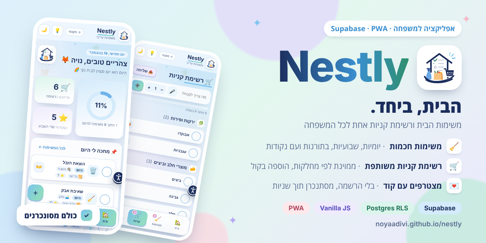
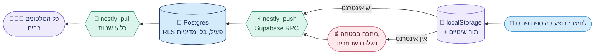

<div dir="rtl">

<p align="center">
  <a href="https://noyaadivi.github.io/nestly/"></a>
</p>

<p align="center"><a href="README.md"></a></p>

<p align="center">
  <a href="https://noyaadivi.github.io/nestly/"></a>
  <a href="supabase.sql"></a>
  <a href="#run-locally"></a>
</p>

<p align="center">
  <a href="https://github.com/NoyaAdivi/nestly/deployments"></a>
  <a href="https://github.com/NoyaAdivi/nestly/commits/main"></a>
  <a href="https://github.com/NoyaAdivi/nestly/search?l=javascript"></a>
  <a href="https://github.com/NoyaAdivi/nestly"></a>
</p>

<h3 align="center">הבית, ביחד. 🏡</h3>

<p align="center">
  Nestly מרכז את <b>משימות הבית ורשימת קניות אחת משותפת</b> לכל המשפחה, במקום אחד.<br>
  כל אחד מצטרף מהטלפון שלו עם קישור, קוד או QR, בלי הרשמה ובלי סיסמאות,<br>
  וכל שינוי מופיע אצל כולם תוך שניות, גם אחרי זמן בלי אינטרנט.
</p>

<table align="center" dir="rtl">
  <tr>
    <td align="center" width="25%"><a href="app.js"><b>🧹 משימות חכמות</b></a><br><sub>חוזרות, בתורנות ועם נקודות</sub></td>
    <td align="center" width="25%"><a href="app.js"><b>🛒 רשימת קניות אחת</b></a><br><sub>ממוינת לפי מחלקות בסופר</sub></td>
    <td align="center" width="25%"><a href="supabase.sql"><b>🔒 מאובטח ב־Postgres</b></a><br><sub>RLS ופונקציות שרת</sub></td>
    <td align="center" width="25%"><a href="sw.js"><b>📲 אפליקציה להתקנה</b></a><br><sub>עובדת אופליין ומסתנכרנת</sub></td>
  </tr>
</table>

<p align="center">
  <a href="https://noyaadivi.github.io/nestly/"></a>
</p>

<p align="center">
  <a href="https://noyaadivi.github.io/nestly/"></a>
</p>

<a name="what"></a>
<p align="center"><a href="#sync"></a></p>

<table dir="rtl">
  <tr valign="top">
    <td valign="top" width="33%" dir="rtl">
      <p><b>🧹 משימות שמנהלות את עצמן</b></p>
      <ul>
        <li><a href="app.js"><b>חוזרות</b></a>: כל יום, בימים שבוחרים, כל כמה ימים או פעם בחודש</li>
        <li>משימה שסיימו <b>קופצת לבד לתאריך הבא</b></li>
        <li><b>תורנות הוגנת</b>: עוברת לבן הבית הבא בכל פעם</li>
        <li><b>30 משימות מוכנות</b> לפי חדרים, הוספה בלחיצה</li>
      </ul>
    </td>
    <td valign="top" width="33%" dir="rtl">
      <p><b>🛒 רשימת קניות שכולם חולקים</b></p>
      <ul>
        <li>הפריטים <b>מתמיינים לבד לפי מחלקות</b>, עם כמות והערות</li>
        <li><b>הרבה בבת אחת</b> עם פסיקים (חלב, ביצים, לחם) או <b>בקול</b> 🎤</li>
        <li>הצעות <b>"לקנות שוב"</b> ממה שקניתם בעבר</li>
        <li><b>שליחת הרשימה</b> בוואטסאפ, בתפריט השיתוף או כטקסט</li>
      </ul>
    </td>
    <td valign="top" width="33%" dir="rtl">
      <p><b>🏆 נקודות ואלופי השבוע</b></p>
      <ul>
        <li>משימה קלה, בינונית וקשה שוות <b>5, 10 ו־20 נקודות</b></li>
        <li><b>טבלת מובילים</b> שמתאפסת בכל יום ראשון</li>
        <li><b>טבעת התקדמות יומית</b> ורשימת "מחכה לי היום"</li>
        <li><a href="app.js"><b>קונפטי</b></a> כשמסיימים משימה 🎉</li>
      </ul>
    </td>
  </tr>
  <tr valign="top">
    <td valign="top" width="33%" dir="rtl">
      <p><b>💌 מצטרפים תוך שניות</b></p>
      <ul>
        <li><b>קוד בית של 6 תווים</b>, קישור או QR</li>
        <li><b>בלי הרשמה ובלי סיסמאות</b>, בוחרים שם ודמות</li>
        <li><b>מי אני</b> במכשיר הזה, אפשר להחליף מתי שרוצים</li>
      </ul>
    </td>
    <td valign="top" width="33%" dir="rtl">
      <p><b>♿ נגיש ורגוע</b></p>
      <ul>
        <li><a href="noya-kit.js"><b>כפתור נגישות שאפשר להזיז</b></a>: גודל טקסט, ניגודיות, גופן קריא, סמן גדול, גווני אפור, עצירת אנימציות</li>
        <li><b>מצב כהה</b>, תמיכה במקלדת ובקורא מסך</li>
        <li><b>ביטול בכל מקום</b>: סימון, מחיקה וניקוי אפשר לבטל</li>
      </ul>
    </td>
    <td valign="top" width="33%" dir="rtl">
      <p><b>✨ פסטלי ומלא תנועה</b></p>
      <ul>
        <li><a href="styles.css"><b>צבעים מתוך הלוגו</b></a>: כחול כהה, תכלת, מנטה, לילך וורוד עדין</li>
        <li><b>גרדיאנטים זורמים</b>, רקע זוהר רך וכרטיסי זכוכית</li>
        <li><a href="fx.js"><b>חשיפה בגלילה, הטיית כרטיסים, אדוות</b></a> ונצנצים</li>
        <li><a href="faq.js"><b>שאלות נפוצות עם חיפוש</b></a> ומדריך קצר "איך זה עובד"</li>
      </ul>
    </td>
  </tr>
</table>

<a name="sync"></a>
<p align="center"><a href="#tech-stack"></a></p>

</div>



<div dir="rtl">

<p align="center"><sub>כל שינוי נשמר קודם במכשיר, כך ששום דבר לא הולך לאיבוד בלי אינטרנט. בהתנגשות, הכתיבה האחרונה קובעת. הלוגיקה: <a href="app.js">app.js</a> · צד השרת: <a href="supabase.sql">supabase.sql</a></sub></p>

<a name="tech-stack"></a>
<p align="center"><a href="#security"></a></p>

<p align="center"><b>צד לקוח</b><br>
<a href="https://developer.mozilla.org/docs/Web/HTML"></a>
<a href="https://developer.mozilla.org/docs/Web/CSS"></a>
<a href="https://developer.mozilla.org/docs/Web/JavaScript"></a>
</p>

<p align="center"><b>צד שרת</b><br>
<a href="https://supabase.com"></a>
<a href="https://www.postgresql.org"></a>
</p>

<p align="center"><b>אפליקציה</b><br>
<a href="https://web.dev/explore/progressive-web-apps"></a>
<a href="https://developer.mozilla.org/docs/Web/API/Service_Worker_API"></a>
<a href="https://developer.mozilla.org/docs/Web/API/Web_Speech_API"></a>
</p>

<p align="center"><b>אחסון</b><br>
<a href="https://pages.github.com"></a>
</p>

<a name="security"></a>
<p align="center"><a href="#run-locally"></a></p>

| חוק | איפה הוא נאכף |
|---|---|
| אי אפשר לקרוא או לכתוב לטבלאות ישירות | RLS פעיל בלי מדיניות, ב־[`supabase.sql`](supabase.sql) |
| מגיעים לנתונים רק עם קוד הבית | הפונקציות `nestly_pull` ו־`nestly_push` |
| קוד בית חייב להיות 6 אותיות או ספרות | הפונקציה `nestly_create` |
| עד 500 שורות בכל סנכרון ועד 20KB לשורה | הפונקציה `nestly_push` |
| מחיקת בית מוחקת את כל הנתונים שלו | מפתח זר עם `on delete cascade` |

> [!NOTE]
> באתר יש רק את מפתח ה־**anon** הציבורי. כל החוקים האמיתיים יושבים בתוך Postgres, כך שגם מי שיש לו את המפתח לא יכול לראות בתים אחרים.

<a name="run-locally"></a>
<p align="center"><a href="#contact"></a></p>

1. פותחים פרויקט חינמי ב־[Supabase](https://supabase.com/dashboard).
2. נכנסים ל־**SQL Editor**, מדביקים את כל [`supabase.sql`](supabase.sql) ולוחצים **Run**.
3. מעתיקים את ה־Project URL ואת מפתח ה־anon public לתוך [`config.js`](config.js).
4. מריצים את התיקייה עם שרת סטטי כלשהו, למשל `npx serve .`

</div>

```js
window.NESTLY_CONFIG = {
  supabaseUrl: 'https://your-project.supabase.co',
  supabaseAnonKey: 'your-anon-key'
};
```

<div dir="rtl">

> [!TIP]
> משאירים את `config.js` ריק ו־Nestly רץ במצב מקומי על מכשיר אחד, נוח בשביל לנסות.

> [!WARNING]
> משתמשים רק במפתח ה־**anon**. אף פעם לא שמים בקובץ את מפתח ה־`service_role` או מפתח סודי.

</div>

<details dir="rtl">
<summary><b>📂 מבנה הפרויקט</b></summary>

```
nestly/
├── index.html            מעטפת האפליקציה, ניווט, חלון
├── styles.css            עיצוב פסטלי מתוך הלוגו, אנימציות, מצב כהה
├── app.js                משימות, קניות, בני בית, סנכרון, היכרות
├── config.js             כתובת Supabase ומפתח anon
├── supabase.sql          טבלאות, אבטחה ופונקציות (מריצים פעם אחת)
├── noya-kit.js           כפתור נגישות שאפשר להזיז + מצב כהה
├── noya-app.js           שאלות נפוצות לפי נושא, התקנה כאפליקציה, פס גלילה
├── fx.js                 חשיפה בגלילה, אדוות, נצנצים
├── faq.js                השאלות והתשובות של Nestly
├── sw.js                 Service Worker לעבודה אופליין
├── manifest.webmanifest  הגדרות התקנה כאפליקציה
├── logo.svg · icon.svg   לוגו מונפש ואייקון
├── icon-*.png            אייקונים (180, 192, 512)
└── docs/                 גרפיקה ל־README ובאנרים
```

</details>

<div dir="rtl">

<details>
<summary><b>🙏 קרדיטים</b></summary>

אימוג׳י מהגופן של המכשיר · גופנים [Rubik](https://fonts.google.com/specimen/Rubik) ו־[Fredoka](https://fonts.google.com/specimen/Fredoka) (SIL Open Font License) · קודי QR באמצעות [qrcode-generator](https://github.com/kazuhikoarase/qrcode-generator) (MIT)
</details>

<a name="contact"></a>
<p align="center"><a href="https://www.linkedin.com/in/noya-adivi/"></a></p>

<p align="center">
  <a href="https://noyaadivi.github.io/nestly/"></a>
  <a href="https://www.linkedin.com/in/noya-adivi/"></a>
  <a href="https://noyaadivi.github.io/noya-website"></a>
  <a href="https://github.com/NoyaAdivi"></a>
</p>

</div>
