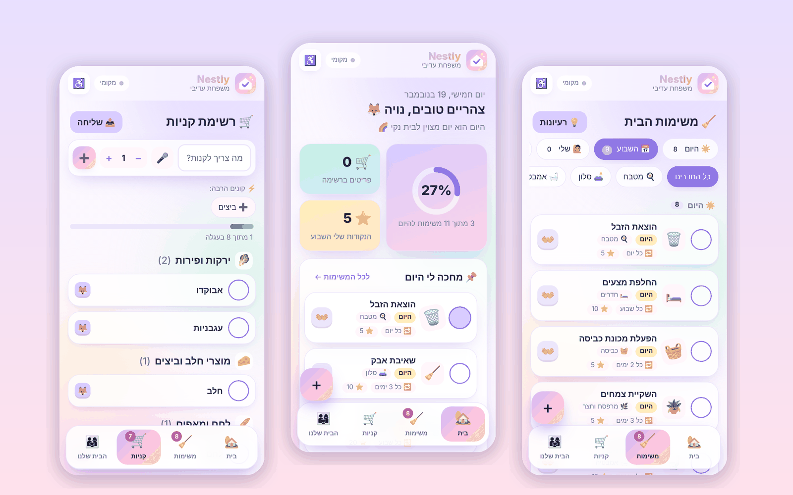

<div align="center">

[](https://noyaadivi.github.io/nestly/)

# Nestly

**English** · [עברית](README.he.md)

**Home, together** 🏡

Household chores and a shared shopping list for the whole family. Everyone joins from their own phone with a link or a code, and every change shows up for everyone within seconds.

### [🌐 Open the live site: noyaadivi.github.io/nestly](https://noyaadivi.github.io/nestly/)

[](https://noyaadivi.github.io/nestly/)

</div>

* * *

## ✨ Features

- 🧹 **Smart recurring chores**: daily, on chosen weekdays, every X days or monthly. A finished chore jumps to its next date by itself
- 🔄 **Fair rotation**: a rotating chore passes to the next family member every time it is done
- 🏆 **Points and weekly champions**: easy, medium and hard chores earn 5, 10 and 20 points. The leaderboard resets every Sunday
- 🛒 **Shared shopping list**: items sort themselves by supermarket aisle, with quantities, notes and "buy again" suggestions
- ⚡ **Quick adding**: several items at once with commas (milk, eggs, bread) or by voice 🎤
- 💌 **Join by link, code or QR**: no sign up and no passwords
- 💡 **30 ready-made chores** grouped by room, one tap to add
- 📤 **Send the list** on WhatsApp, through the share menu or as copied text
- ↩️ **Undo everywhere**: completing, deleting and clearing can all be undone
- 🎉 **Delight**: confetti, pastel animations and emoji throughout
- ♿ **Accessible**: text size, dark mode, high contrast, readable font, stop animations, keyboard and screen reader support
- 📲 **Installable app (PWA)**: add to the home screen, works offline and syncs when back online
- 💾 **Backup**: download all the household data as a JSON file

## 🛠️ Tech stack

| Part | Technology |
|---|---|
| Front end | HTML, CSS and vanilla JavaScript, no build step |
| Database | [Supabase](https://supabase.com) (Postgres functions and Row Level Security) |
| Sync | Outbox of local changes plus polling every 5 seconds, last write wins |
| Offline | Service Worker and localStorage |
| Hosting | [GitHub Pages](https://pages.github.com) |
| Font | [Rubik](https://fonts.google.com/specimen/Rubik) |

## 🔒 Data rules (enforced in the database)

| Rule | Where |
|---|---|
| Tables can't be read or written directly | RLS enabled with no policies, in [`supabase.sql`](supabase.sql) |
| Data is reachable only with the household code | `nestly_pull`, `nestly_push` functions |
| Household codes must be 6 letters or digits | `nestly_create` function |
| Up to 500 rows per sync and 20 KB per row | `nestly_push` function |
| Deleting a household removes all its data | `on delete cascade` foreign key |

## 📂 Project structure

```
nestly/
├── index.html            app shell, navigation, dialog
├── styles.css            pastel design, animations, dark mode, accessibility modes
├── app.js                all logic: chores, shopping, members, sync, onboarding
├── config.js             Supabase URL and anon key
├── supabase.sql          tables, security and functions (run once)
├── sw.js                 offline Service Worker
├── manifest.webmanifest  installable app settings
├── icon.svg              logo
├── icon-192.png          app icon
├── icon-512.png          app icon
└── nestly.png            screenshot
```

## 💻 Running locally

1. Create a free project on [Supabase](https://supabase.com/dashboard)
2. Open SQL Editor, paste all of [`supabase.sql`](supabase.sql) and press Run
3. Copy the Project URL and the anon public key into [`config.js`](config.js):
   ```js
   window.NESTLY_CONFIG = {
     supabaseUrl: 'https://your-project.supabase.co',
     supabaseAnonKey: 'your-anon-key'
   };
   ```
4. Serve the folder with any static server, for example:
   ```bash
   npx serve .
   ```

> ⚠️ Use only the **anon** key. Never put the `service_role` or secret key in this file.
> Leaving `config.js` empty runs the app in local mode on a single device.

## 🙏 Attribution

Emoji by your device's system font · Font [Rubik](https://fonts.google.com/specimen/Rubik) (SIL Open Font License) · QR codes by [qrcode-generator](https://github.com/kazuhikoarase/qrcode-generator) (MIT)

<div align="center">

Made with 💜 by [Noya Adivi](https://github.com/NoyaAdivi)

</div>
