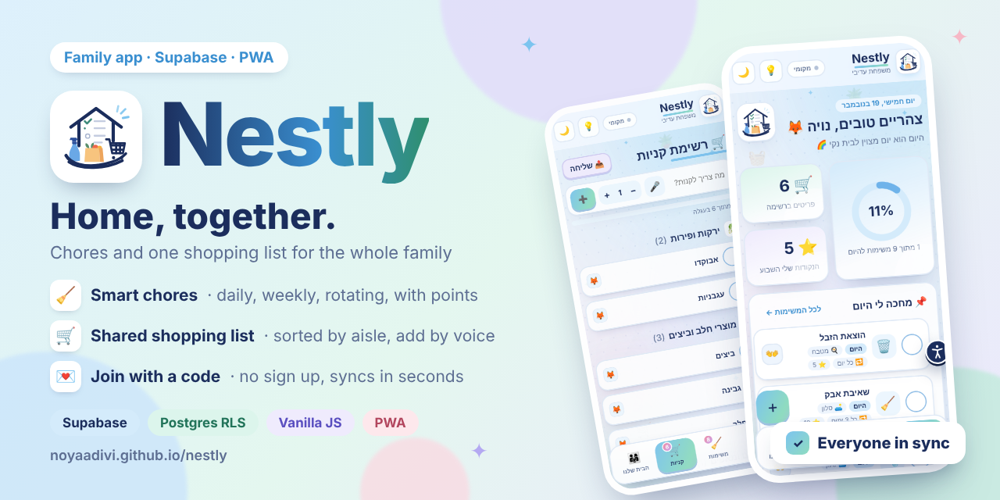
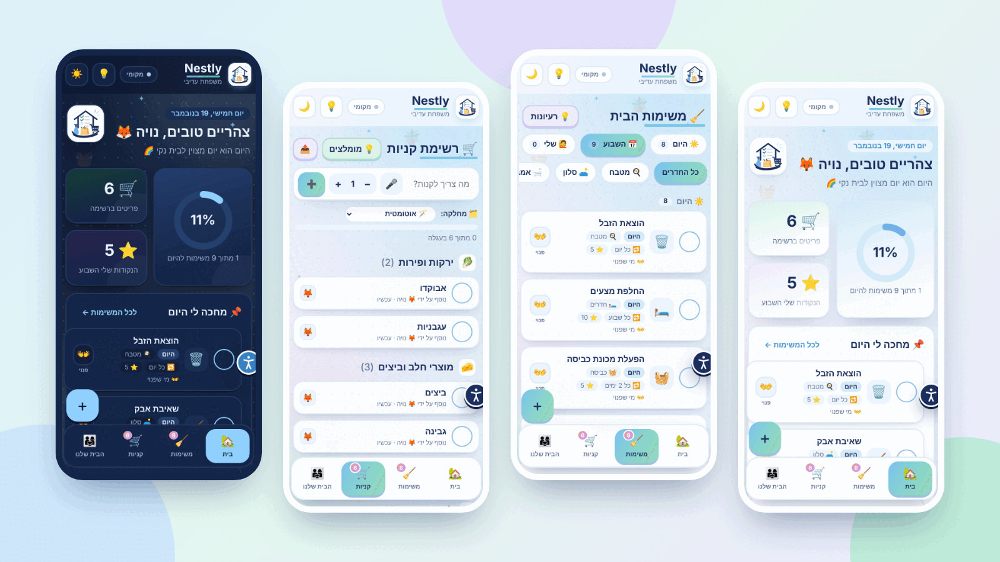
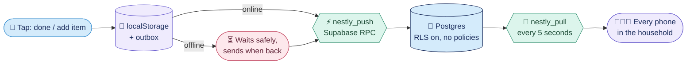

<p align="center">
  <a href="https://noyaadivi.github.io/nestly/"></a>
</p>

<p align="center"><a href="README.he.md"></a></p>

<p align="center">
  <a href="https://noyaadivi.github.io/nestly/"></a>
  <a href="supabase.sql"></a>
  <a href="#run-locally"></a>
</p>

<p align="center">
  <a href="https://github.com/NoyaAdivi/nestly/deployments"></a>
  <a href="https://github.com/NoyaAdivi/nestly/commits/main"></a>
  <a href="https://github.com/NoyaAdivi/nestly/search?l=javascript"></a>
  <a href="https://github.com/NoyaAdivi/nestly"></a>
</p>

<h3 align="center">Home, together. 🏡</h3>

<p align="center">
  Nestly keeps <b>household chores and one shared shopping list</b> in a single place for the whole family.<br>
  Everyone joins from their own phone with a link, a code or a QR, no sign up and no passwords,<br>
  and every change shows up for everyone within seconds, even after being offline.
</p>

<table align="center">
  <tr>
    <td align="center" width="25%"><a href="app.js"><b>🧹 Smart chores</b></a><br><sub>recurring, rotating, with points</sub></td>
    <td align="center" width="25%"><a href="app.js"><b>🛒 One shopping list</b></a><br><sub>sorted by supermarket aisle</sub></td>
    <td align="center" width="25%"><a href="supabase.sql"><b>🔒 Secured in Postgres</b></a><br><sub>RLS and server functions</sub></td>
    <td align="center" width="25%"><a href="sw.js"><b>📲 Installable PWA</b></a><br><sub>works offline, syncs back</sub></td>
  </tr>
</table>

<p align="center">
  <a href="https://noyaadivi.github.io/nestly/"></a>
</p>

<p align="center">
  <a href="https://noyaadivi.github.io/nestly/"></a>
</p>

<a name="what"></a>
<p align="center"><a href="#sync"></a></p>

<table>
  <tr valign="top">
    <td valign="top" width="33%">
      <p><b>🧹 Chores that run themselves</b></p>
      <ul>
        <li><a href="app.js"><b>Recurring</b></a>: daily, chosen weekdays, every X days or monthly</li>
        <li>A finished chore <b>jumps to its next date</b> by itself</li>
        <li><b>Fair rotation</b>: passes to the next family member each time</li>
        <li><b>Tag who does it</b>: tap "Tag" on any chore to assign it</li>
        <li><b>Your own rooms</b>: garden, car, kids room... edit, add or remove</li>
        <li><b>30 ready-made chores</b> grouped by room, one tap to add</li>
      </ul>
    </td>
    <td valign="top" width="33%">
      <p><b>🛒 A shopping list everyone shares</b></p>
      <ul>
        <li>Items <b>sort themselves by aisle</b>, with quantity and notes</li>
        <li><b>Add many at once</b> with commas (milk, eggs, bread) or <b>by voice</b> 🎤</li>
        <li><b>Who added what</b>, a <b>photo of the product</b> and a chosen aisle</li>
        <li><b>Import a whole list</b> from a photo (even handwriting), a PDF or Word file, or pasted text</li>
        <li><b>Recommended list</b> by aisle and <b>"buy again"</b> suggestions</li>
        <li><b>Share only the shopping list</b> with a link: no chores, no household code, and you can cancel it any time</li>
        <li><b>Send the list</b> on WhatsApp, the share menu or as text</li>
      </ul>
    </td>
    <td valign="top" width="33%">
      <p><b>🏆 Points and weekly champions</b></p>
      <ul>
        <li>Easy, medium and hard chores earn <b>5, 10 and 20 points</b></li>
        <li><b>Leaderboard</b> that resets every Sunday</li>
        <li><b>Daily progress ring</b> and "for me today" list</li>
        <li><a href="app.js"><b>Confetti</b></a> when a chore is done 🎉</li>
      </ul>
    </td>
  </tr>
  <tr valign="top">
    <td valign="top" width="33%">
      <p><b>💌 Join in seconds</b></p>
      <ul>
        <li>A <b>6 character household code</b>, a link or a QR</li>
        <li><b>No sign up, no passwords</b>, pick a name and an avatar</li>
        <li><b>Who am I</b> on this device, switchable any time</li>
      </ul>
    </td>
    <td valign="top" width="33%">
      <p><b>♿ Accessible and calm</b></p>
      <ul>
        <li><a href="noya-kit.js"><b>Draggable accessibility button</b></a>: text size, contrast, readable font, big cursor, grayscale, stop motion</li>
        <li><b>Dark mode</b>, keyboard and screen reader support</li>
        <li><b>Undo everywhere</b>: done, delete and clear can be undone</li>
        <li><b>Accessibility statement</b>, privacy policy and terms of use</li>
      </ul>
    </td>
    <td valign="top" width="33%">
      <p><b>✨ Pastel and full of motion</b></p>
      <ul>
        <li><a href="styles.css"><b>Colors from the logo</b></a>: navy, sky, mint, lilac and blush</li>
        <li><b>Flowing gradients</b>, a soft aurora background and glass cards</li>
        <li><a href="fx.js"><b>Scroll reveals, card tilt, ripples</b></a> and sparkle bursts</li>
        <li><a href="faq.js"><b>Searchable FAQ</b></a> and a quick "how it works" guide</li>
      </ul>
    </td>
  </tr>
</table>

<a name="sync"></a>
<p align="center"><a href="#tech-stack"></a></p>



<p align="center"><sub>Every change is saved on the device first, so nothing is lost offline. Conflicts resolve by last write wins. Logic: <a href="app.js">app.js</a> · Server side: <a href="supabase.sql">supabase.sql</a></sub></p>

<a name="tech-stack"></a>
<p align="center"><a href="#security"></a></p>

<p align="center"><b>Front end</b><br>
<a href="https://developer.mozilla.org/docs/Web/HTML"></a>
<a href="https://developer.mozilla.org/docs/Web/CSS"></a>
<a href="https://developer.mozilla.org/docs/Web/JavaScript"></a>
</p>

<p align="center"><b>Backend</b><br>
<a href="https://supabase.com"></a>
<a href="https://www.postgresql.org"></a>
</p>

<p align="center"><b>App</b><br>
<a href="https://web.dev/explore/progressive-web-apps"></a>
<a href="https://developer.mozilla.org/docs/Web/API/Service_Worker_API"></a>
<a href="https://developer.mozilla.org/docs/Web/API/Web_Speech_API"></a>
</p>

<p align="center"><b>Hosting</b><br>
<a href="https://pages.github.com"></a>
</p>

<a name="security"></a>
<p align="center"><a href="#run-locally"></a></p>

| Rule | Where it is enforced |
|---|---|
| Tables can't be read or written directly | RLS enabled with no policies, in [`supabase.sql`](supabase.sql) |
| Data is reachable only with the household code | `nestly_pull` and `nestly_push` functions |
| Household codes must be 6 letters or digits | `nestly_create` function |
| Up to 500 rows per sync and 20 KB per row | `nestly_push` function |
| Deleting a household removes all its data | `on delete cascade` foreign key |
| A shopping list link reads and writes only the list | `nestly_list_pull` and `nestly_list_push` with a separate 12 character token |

> [!NOTE]
> The site only holds the public **anon** key. All the real rules live inside Postgres, so even a curious visitor with the key can't list other households.

<a name="run-locally"></a>
<p align="center"><a href="#contact"></a></p>

1. Create a free project on [Supabase](https://supabase.com/dashboard).
2. Open **SQL Editor**, paste all of [`supabase.sql`](supabase.sql) and press **Run**.
3. Copy the Project URL and the anon public key into [`config.js`](config.js):
   ```js
   window.NESTLY_CONFIG = {
     supabaseUrl: 'https://your-project.supabase.co',
     supabaseAnonKey: 'your-anon-key'
   };
   ```
4. Serve the folder with any static server:
   ```bash
   npx serve .
   ```

> [!TIP]
> Leave `config.js` empty and Nestly runs in local mode on one device, handy for trying it out.

> [!WARNING]
> Use only the **anon** key. Never put the `service_role` or secret key in this file.

<details>
<summary><b>📂 Project structure</b></summary>

```
nestly/
├── index.html            app shell, navigation, dialog
├── styles.css            pastel design from the logo, animations, dark mode
├── app.js                chores, shopping, members, sync, onboarding
├── config.js             Supabase URL and anon key
├── supabase.sql          tables, security and functions (run once)
├── noya-kit.js           draggable accessibility button + dark mode
├── noya-app.js           FAQ by topic, install as app, scroll progress
├── fx.js                 scroll reveals, ripples, sparkle bursts
├── faq.js                Nestly's questions and answers
├── sw.js                 offline Service Worker
├── manifest.webmanifest  installable app settings
├── logo.svg · icon.svg   animated logo and app icon
├── icon-*.png            app icons (180, 192, 512)
└── docs/                 README art and social banners
```
</details>

<details>
<summary><b>🙏 Credits</b></summary>

Emoji by your device's system font · Fonts [Rubik](https://fonts.google.com/specimen/Rubik) and [Fredoka](https://fonts.google.com/specimen/Fredoka) (SIL Open Font License) · QR codes by [qrcode-generator](https://github.com/kazuhikoarase/qrcode-generator) (MIT)
</details>

<a name="contact"></a>
<p align="center"><a href="https://www.linkedin.com/in/noya-adivi/"></a></p>

<p align="center">
  <a href="https://noyaadivi.github.io/nestly/"></a>
  <a href="https://www.linkedin.com/in/noya-adivi/"></a>
  <a href="https://noyaadivi.github.io/noya-website"></a>
  <a href="https://github.com/NoyaAdivi"></a>
</p>
